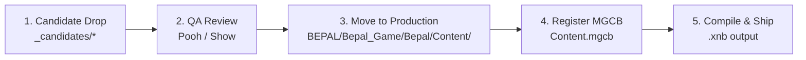

# Asset Candidates Staging Area

This directory serves as the raw staging landing zone for external, free, or newly created asset candidates (2D art, sound effects, background music, and typography) before they are approved by QA and compiled via the MonoGame Content Pipeline (MGCB).

Non-programmer team members (**Dear** for 2D Art, **Pooh** for Audio/SFX) should place raw candidates here before pipeline integration.

Asset inventory, status and file names: [05-asset-list.md](../../Docs/GDD/05-asset-list.md) (art) and [14-audio-fonts-list.md](../../Docs/GDD/14-audio-fonts-list.md) (SFX/BGM/fonts). Code architecture: [CLAUDE.md](../../../CLAUDE.md).

---

## Directory Structure

```
BEPAL/Assets/_candidates/
├── sprites/       # Raw PNG sprites, badges, UI elements, and concept art
├── sfx/           # Raw sound effect audio files (WAV)
├── music/         # Raw ambient and background music tracks (MP3/WAV)
└── fonts/         # TrueType / OpenType font sources (.ttf, .otf)
```

---

## Technical Specifications

### 1. 2D Sprites & UI Graphics (`sprites/`)
- **Format**: PNG with 32-bit transparent RGBA channel.
- **Pet Emotion Sprites**:
  - **Resolution**: 280 × 360 px.
  - **Naming Convention**:
    - `spr_<pet>_idle.png` (e.g., `spr_mossling_idle.png`)
    - `spr_<pet>_happy.png` (e.g., `spr_mossling_happy.png`)
    - `spr_<pet>_angry.png` (e.g., `spr_mossling_angry.png`)
  - `<pet>` = lowercase species name from `Species` in `Model/Pet.cs`: `mossling`, `nibbleclaw`, `blinkbun`, `toothless`.
- **Backgrounds**:
  - **Resolution**: 1280 × 720 px (16:9 native backbuffer ratio).
  - **Naming Convention**: `bg_<scene>.png` (e.g., `bg_daycare_shelter.png`).
- **Scrap Badges & UI Assets**:
  - Transparent PNG, pixel-aligned, sized according to layout requirements (e.g. 160 × 48 px or 220 × 48 px).

### 2. Audio & Sound Effects (`sfx/` & `music/`)
- **Sound Effects (`sfx/`)**:
  - **Format**: 44.1 kHz, 16-bit PCM Uncompressed WAV.
  - **Channels**: Mono or Stereo (Mono preferred for localized positional effects).
  - **Naming Convention**: `sfx_<action>_<descriptor>.wav` (e.g., `sfx_qte_tick.wav`, `sfx_qte_hit.wav`, `sfx_qte_miss.wav`, `sfx_pet_react.wav`, `sfx_warning_siren.wav`).
- **Background Music (`music/`)**:
  - **Format**: 44.1 kHz, 16-bit or 320 kbps MP3 / WAV.
  - **Loops**: Seamless loop point alignment.
  - **Naming Convention**: `bgm_<theme>.mp3` (e.g., `bgm_shelter_day.mp3`, `bgm_death_spiral.mp3`).

### 3. Fonts (`fonts/`)
- **Format**: TTF or OTF (compatible with BMFont / MonoGame FontDescriptionProcessor).
- **License**: SIL Open Font License or CC0/Free for commercial use.

---

## Asset Staging Lifecycle



1. **Candidate Drop**: Teammate places new raw candidate file into appropriate folder (`sprites/`, `sfx/`, `music/`, `fonts/`).
2. **QA & Design Review**: Team reviews visual style, dimensions, volume levels, and audio clipping.
3. **Move to Production**: Approved assets are moved into `BEPAL/Bepal_Game/Bepal/Content/` (subfolders `Sprites/`, `Sfx/`, `Music/`, `Fonts/`) with canonical names.
4. **Register in MGCB**: Add asset reference into `Content/Content.mgcb` with appropriate importer and processor settings (`dotnet mgcb-editor` from `BEPAL/Bepal_Game/Bepal/`).
5. **Compile & Commit**: Build pipeline compiles `.xnb` artifacts, verified via `dotnet build` and `dotnet run -- --autoplay` (see [CLAUDE.md](../../../CLAUDE.md)).

> **Current state (2026-10-07):** 7 PNGs in `Content/Sprites/` — `bg_parallax_{sky,clouds,hills,mid,near}.png` (copies of `sprites/Hexagon/hexagon_5..1.png`, 320x180 drawn at 4x by `World/Backdrop.cs`), `fg_jungle.png` and `player.png` (all `TextureImporter`/`TextureProcessor`, `PremultiplyAlpha=True`) — plus 17 SFX in `Content/Sfx/` (WAV 16-bit PCM, `WavImporter` + `SoundEffectProcessor`, `Quality=Best`), played through `Core/Audio.cs` (`Sfx` name constants). Everything else is still drawn from primitives; BGM (`music/*.ogg`) is wired: copies live in `Content/Music/` (`OggImporter` + `SongProcessor`) and play through `Core/MusicPlayer.cs`. Inventory and status: [05-asset-list.md](../../Docs/GDD/05-asset-list.md); architecture: [CLAUDE.md](../../../CLAUDE.md). To add an SFX: drop the WAV in `sfx/`, copy to `Content/Sfx/`, register in `Content.mgcb`, add the name to `Sfx.All`.
> **In game (2026-10-24):** `pet/spr_Mossling|Nibbleclaw|Blinkbun.png` → `Content/Sprites/pet_<species>.png`, `player/spr_player.PNG` → `Content/Sprites/player.png` (replaced the old pixel-art player). Each was cropped to its opaque box, mirrored to face right where needed (Mossling and Blinkbun; Nibbleclaw and the player are not mirrored), Lanczos-resized to 256 px tall and registered with `GenerateMipmaps=True`; painted sprites draw with `LinearClamp`. Redo the same steps when an artist updates a source file.
> **UI (2026-10-24):** `ui/ui_status_panel.png` → `Content/Sprites/ui_status_panel.png` as-is (396x332, mipmaps). `CareSelectScene.PetStats` draws it at 264x221 and places text/bars by fixed image-pixel coordinates (header 20,19 356x80; slots x26 w344 h32 at y 110/154/198/242, in `CareScenes.cs`) — if the art's layout changes, update those numbers.
> **Item cards (2026-10-25):** `ui/Item/slot_frame.png`, `slot_frame_Button.png`, `slot_frame_Button_hold.png` → `Content/Sprites/ui_item_slot.png`, `ui_item_button.png`, `ui_item_button_hold.png` as-is (all 270x230 = `Items.CardW/CardH`, mipmaps). `ItemCards` (shop + box carousel, `BaseMenus.cs`) draws the frame scaled to the card; the Buy/Use `Button` draws the button art from `Ui.ItemButtonSrc` (25,183 220x40 — also where `Items.ButtonRect` puts the hit box), the `_hold` file while the mouse is held on it, greyed when disabled. Card text uses `Ui.CardInk`. If the art's button moves, update `Ui.ItemButtonSrc`.
> **Character sprites (wired 2026-10-13, `World/Art.cs`):** pets, enemies, the merchant and the doctor use a real image when one is registered, otherwise the primitive drawing. One still image each, facing **right** (the game mirrors it toward whatever it looks at), transparent PNG, any size (the opaque bounding box is found automatically, so crop padding does not matter; the bottom edge of the opaque pixels is the feet). Idle breathing/bob is procedural (`SpriteMotion` pose), drawn point-sampled like `player.png`. To add one: copy the approved PNG to `BEPAL/Bepal_Game/Bepal/Content/Sprites/<name>.png`, register it in `Content/Content.mgcb` (same `TextureImporter`/`TextureProcessor`/`PremultiplyAlpha=True` block as `player.png`), `dotnet build`, then check with `dotnet run -- --shots <dir>`.

| `<name>` | Replaces | Drawn height (px, `Art.cs` constants) |
|---|---|---|
| `pet_mossling`, `pet_nibbleclaw`, `pet_blinkbun`, `pet_toothless` | `Art.Pet` (every screen incl. fight; the idle pose of PET-01/05/09/13) | 90 x scale |
| `enemy_toothless` | Toothless as a fight enemy (falls back to `pet_toothless`, then the primitive) | 150 |
| `enemy_bigz` | Big Z (Day 5 fight + intro portrait) | 230 x `Enemy.Size` |
| `npc_merchant` | `Art.Merchant` | 220 |
| `npc_doctor` | `Art.Doctor` | 125 |

> Only the idle image is used for now: attack/hurt/happy poses (PET-02..04 etc.) are not wired; a hurt flash tints the sprite red. If a sprite looks too big/small, change the height constants at the top of `Art.cs`.
> **SFX format decision:** WAV only. The source pack also had aiff/flac/m4a/mp3/ogg copies of each sound; they are not kept in the repo (SFX are short, WAV has the lowest latency and no codec risk on DesktopGL).
