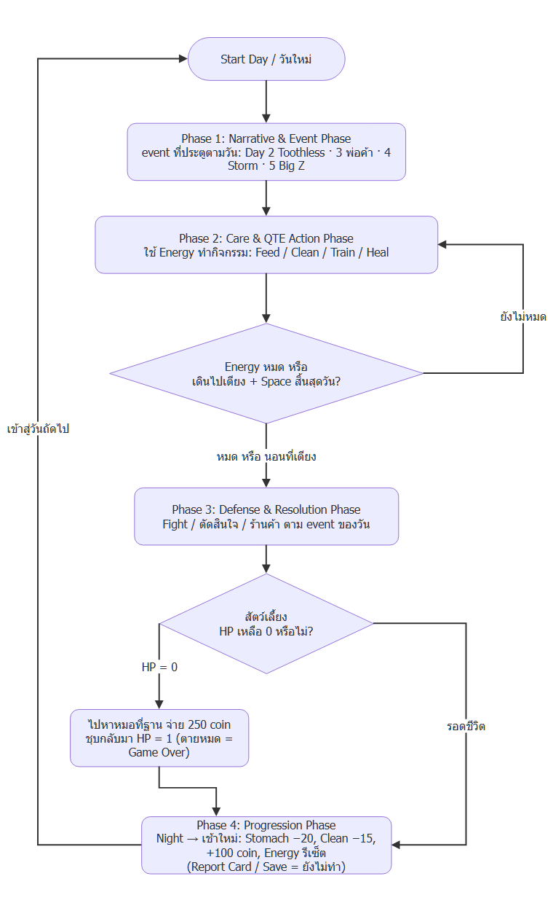
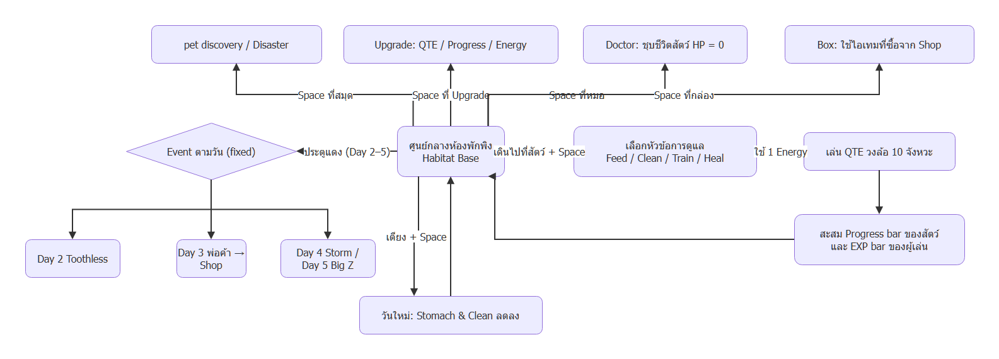

# BePal — Core Loop & Gameplay Flow

> **หมายเหตุ:** ปรับให้ตรงกับโค้ดแล้วเมื่อ 2026-10-13 — [06-vertical-slice.md](06-vertical-slice.md) และโค้ดยังเป็นข้อกำหนดหลักของ Prototype
> **Prototype as built:** Day 1–5 กำหนดตายตัว (Day 2 Toothless · Day 3 พ่อค้า · Day 4 พายุ · Day 5 Big Z → "To be continued") ไม่มีระบบสุ่ม/Endless, ไม่มี Report Card/Save · ข้อความเกี่ยวกับสิ่งเหล่านี้ด้านล่างเป็น**แนวคิดเดิม (future)

## Core Daily Loop

วงจรการเล่นหลักของ BePal ถูกออกแบบให้เป็นวัฏจักรประจำวัน 4 เฟส (4-Phase Daily Loop) ที่ผู้เล่นต้องบริหารจัดการเวลา พลังงาน และสถานะของสัตว์เลี้ยง ท่ามกลางวิกฤตและเหตุการณ์ไม่คาดฝัน:

> Draw.io: [diagrams/core-loop-day.drawio](diagrams/core-loop-day.drawio) (เปิดด้วย VS Code Draw.io Integration)

---

### Core Loop ตาม Figma (05 · Game Loop)

> Draw.io: [diagrams/core-loop-base.drawio](diagrams/core-loop-base.drawio) (เปิดด้วย VS Code Draw.io Integration)

> ลำดับจริงใน Figma: ผู้เล่นกด **End day** ได้ทุกเมื่อ → ขึ้นวันใหม่ (ค่า Stomach และ Clean ลดลง เพื่อกันการ skip day โดยไม่ทำอะไร) → ตั้งแต่ Day 2 ประตูจะมี "Knock Knock !!" ให้เดินไปกด `Space` เปิดรับ Event (ต้องจัดการ event ก่อนจึงจะ End day ได้)

---

## Detailed Breakdown of the 4-Phase Daily Cycle

### Phase 1: Narrative & Morning Event Phase (ยามเช้าและข่าวสาร)
1. **Morning Briefing:** เมื่อเริ่มต้นวันแรก ระบบจะยังไม่มี event อะไร เพื่อให้ผู้เล่นได้เรียนรู้กับระบบเสียก่อน
2. **Doorstep Arrival Check:** ในวันที่กำหนด (เช่น Day 2 มีเสียง "Knock Knock !!", Day 3 มีรถเข็นพ่อค้าเร่มาจอด) ประตูแดงคู่จะมีไอคอนแจ้งเตือนให้ผู้เล่นตรวจสอบเหตุการณ์ภายนอก

### Phase 2: Care & QTE Action Phase (การดูแลและบริหารพลังงาน)
1. **Energy Budgeting:** ผู้เล่นได้รับแต้มพลังงานเริ่มต้น **3 AP** ต่อวัน (อัปเกรดเพิ่มได้ที่ Upgrade → Energy สูงสุด 6 AP) — **กดเข้าหน้า QTE = -1 Energy**
2. **Action Selection:** ผู้เล่นเลือกทำกิจกรรมการดูแลจาก 4 หมวดหมู่หลัก:
   - **Feed (ให้อาหาร):** ใช้ 1 AP ฟื้นฟูค่า Stomach และให้ EXP player
   - **Clean (ทำความสะอาด):** ใช้ 1 AP ขจัดสิ่งสกปรก ฟื้นฟูค่า Clean เพื่อไม่ให้สัตว์เลี้ยงสกปรก หาสัตว์เลี้ยงสกปรก (Clean ≤ 50) สัตว์ตัวนั้นจะโจมตีเบาลง และถ้า Clean ≤ 25 จะทำให้ Max HP ลดลงอีกด้วย
   - **Train (ฝึกฝนทักษะ):** ใช้ 1 AP เพิ่มระดับเลเวลสัตว์เลี้ยงและ EXP player แต่ลดค่า Stomach
   - **Heal (รักษาพยาบาล):** ใช้ 1 AP (หรือร่วมกับไอเทมยา) ฟื้นฟูค่า Health ที่สูญเสีย
3. **Action Select Wheel (Scene 4 — Care pet):** เดินไปใกล้สัตว์ + `Space` → วงล้อ QTE ที่มี choice 4 สี (Train/Feed/Clean/Heal) กด Spacebar ตรง choice ไหนจะไปหน้า QTE นั้น (กดไม่โดน = ไม่เกิดอะไรขึ้น), ESC = กลับหน้า Base, กดโดนแล้วจอสั่น (feedback)
4. **10-Attempt Mini-Game Execution:** แต่ละแอ็กชันจะตัดเข้าสู่หน้าจอมินิเกมวงล้อ QTE — กด Spacebar ได้ **10 ครั้ง** (Attempt : 10) ผู้เล่นต้องจับจังหวะกดในโซน Perfect หรือ Great เมื่อกดครบจะกลับ Scene Base อัตโนมัติ
4. **Day Progress Accumulation:** ผู้เล่นจะสามารถไปวันต่อไปได้โดยการเดินไปที่เตียงแล้วกด `Space`/`Enter` สิ้นสุดวันเพื่อข้ามช่วงเวลา

### Phase 3: Defense & Resolution Phase (การเผชิญหน้าและการต่อสู้)
1. **Combat Readiness Condition (กฎความสะอาดก่อนออกรบ):**
   - **Clean ≤ 50:** สัตว์เลี้ยงจะโจมตีเบาขึ้น (ATK ×0.75 เช่น 20 --> 15) และถ้า Clean ≤ 25 จะทำให้ Max HP ของสัตว์ตัวนั้นลดลงอีกด้วย (×0.8 เช่น 100 --> 80)
1. **Dynamic Encounters:**
   - **Day 1:** เริ่มต้นวันแรก สำรวจสิ่งรอบข้าง เรียนรู้ระบบ 
   - **Day 2 (Toothless Encounter):** สัตว์ป่ากรดพิษบุกเข้ามา ผู้เล่นต้องเลือกว่าจะขับไล่ (Chase) หรือฝึกให้เชื่อง (Tame Combat QTE)
   - **Day 3 (Merchant):** พ่อค้าขอซื้อสัตว์ 5,000 coin — **Sell** (ขายตัวสุดท้ายไม่ได้) หรือ **Refuse** แล้วเปิดร้านค้าทั้งสองทาง *(Prototype ไม่มี Merchant Boss Fight — แนวคิดเดิม 3 เฟส/5 hits เป็น future)*
   - **Day 4 (Disaster):** พายุ (Thunderstorm) ทำให้สัตว์ทุกตัวสกปรก (Clean −50, clamp ที่ 0) ผู้เล่นต้องทำความสะอาดพวกมัน
   - **Day 5 (Big Z):** บอสสู้ไม่ชนะ (HP 9999) → หน้า "To be continued..." จบ Prototype
1. **Combat Loop (Scene 16–19 ใน Figma):**
   - **Pet choice:** เลือก *Chase* (กลับฐาน ไม่ต้องสู้ ไม่เสีย Energy) หรือ *Tame* (เข้าสู่การต่อสู้)
   - **Choose pet to fight:** คลิ๊กเลือกสัตว์ของเราที่จะส่งไปสู้ (hover ขึ้นกรอบรอบตัว)
   - **Fight:** มีหลอด HP ของศัตรู และหลอด HP เล็กๆ บนหัวสัตว์ของเรา วงล้อ QTE มี 2 choice:
     - **Dodge:** มีแค่ zone Perfect ที่ค่อยๆ หดสั้นลง ต้องกดให้โดน ถ้ากดไม่ทันหรือไม่โดน สัตว์เราจะถูกโจมตี
     - **Attack:** มี zone Perfect (ดาเมจ 100% ของ ATK) และ Great (ดาเมจ 75% ของ ATK) — เช่น ATK 100 → Perfect 100 / Great 75
   - ศัตรู HP = 0 → หน้า "You got new pet !!!" (รับสัตว์ตัวใหม่)
   - สัตว์เราตาย (HP = 0) → กลับหน้าเลือกสัตว์เพื่อส่งตัวอื่นมาสู้ต่อ โดย **progress การสู้ยังอยู่** จนกว่าศัตรูจะ HP = 0
   - สัตว์เราตายหมด → **Game Over** แล้วกลับไปเริ่มเลือกสัตว์ใหม่ที่ Scene 2

### Phase 4: Progression & Summary Phase (การสรุปผลและฟื้นฟู)
1. **Daily Stat Decay:** หักลบค่าสเตตัสความต้องการพื้นฐานตามสูตรประจำวัน (Stomach -20, Clean -15) — ทุกครั้งที่เริ่มวันใหม่
2. **Sickness & Penalty Check:** Stomach = 0 → เสีย HP 20 ทุกครั้งที่ End day / Clean ≤ 50 → โจมตีเบาลง / Clean ≤ 25 → Max HP ลดลง
3. **Daily Summary Report Card:** *(ยังไม่ implement — future)* เกรด S–F, โบนัส, Survival Log · As built: ฉาก `NightScene` (fade "Day N is over...") แล้วขึ้น dialogue "Morning" สรุป เช่น "+100 coin, energy restored."
4. **Night Rest:** รีเซ็ตพลังงานกลับเป็น MaxEnergy (`min(3 + EnergyUpgrade, 6)`) สำหรับวันถัดไป · *(ไม่มี Auto-save ใน Prototype)*

---

## The Vertical Slice Progression Timeline (Day 1 - 3+)

> ตารางนี้เป็นแนวคิดเดิม — Timeline ที่ implement จริงอยู่ใน [06 §1](06-vertical-slice.md) (Day 3 ไม่มี Boss Fight, Day 4 = พายุตายตัว, Day 5 = Big Z)

| วันที่               | Phase 1 (Event)                                                                                                        | Phase 2 (Care Focus)                                                                       | Phase 3 (Encounter / Conflict)                                                                                                                            | Phase 4 (Resolution)                                                                               |
| -------------------- | ---------------------------------------------------------------------------------------------------------------------- | ------------------------------------------------------------------------------------------ | --------------------------------------------------------------------------------------------------------------------------------------------------------- | -------------------------------------------------------------------------------------------------- |
| **Day 1**            | - รับสัตว์เลี้ยงเริ่มต้น (Mossling/Nibbleclaw/Blinkbun — ฉายาทีม ไอ่แดง/ไอ่ซุง/ไอ่เขียว)                                     | - ทำความคุ้นเคยกับการใช้ Energy ทำกิจกรรมดูแลสัตว์                                         | - สำรวจเกมเบื้องต้น (ยังไม่มีการต่อสู้หรือภัยพิบัติ เพื่อให้ผู้เล่นทำความเข้าใจระบบการกด QTE)                                                             | - สรุปคะแนนวันแรก - หักค่าสเตตัสรายวัน (Daily Decay) - รับโบนัสเงินสนับสนุนเริ่มต้น          |
| **Day 2**            | - เสียงแจ้งเตือนหน้าประตู "Knock Knock !!" - ร่องรอยคราบกรดสีม่วง                                                   | - บริหารพลังงานและอัปเกรดสถานีฐาน - ตรวจสอบความสะอาดให้อยู่ในเกณฑ์พร้อมรบ (Clean >= 50) | - **Toothless Wild Encounter:** เลือกว่าจะขับไล่ (Chase) หรือฝึกให้เชื่อง (Tame) - เข้าสู่มินิเกมหลบหลีก (Dodge) และสวนกลับ                            | - ปลดล็อก Toothless เข้าเป็นสมาชิกใหม่ (หากเลือก Tame สำเร็จ) - อัปเดตสมุดบันทึก (Survival Log) |
| **Day 3**            | - พ่อค้าเร่เดินทางมาถึง - เปิดระบบร้านค้า (Merchant Shop) ซื้อไอเทมเช่น Crab Apple, Sea Tea ฯลฯ                     | - ซื้อไอเทมบัฟและอาหารฟื้นพลัง - จัดการบริหาร Energy เตรียมพร้อมสัตว์เลี้ยง             | - **The Merchant's Dilemma:** พ่อค้าเสนอเงิน 5,000G เพื่อขอซื้อสัตว์เลี้ยง - หากปฏิเสธ จะเข้าสู่ **Merchant Boss Fight** (ต่อสู้จนกว่าจะตีครบ 5 ครั้ง) | - รับเงินรางวัล (หากต่อสู้ชนะพ่อค้า) - หักค่าสเตตัส สรุปผลประจำวันเพื่อเล่นต่อ                  |
| **Day 4+ (Endless)** | - **ระบบสุ่มเหตุการณ์รายวัน:** - _ตัวอย่าง Event:_ การเผชิญกับภัยธรรมชาติ (เช่น Thunderstorm) หรือมีศัตรูใหม่บุกฐาน | - สัตว์เลี้ยงถูกฝนพายุ ทำให้สัตว์เลี้ยงทุกตัวของเราสกปรก                                   | - บริหาร Energy เพื่อจัดการสถานการณ์ฉุกเฉิน - _ตัวอย่าง:_ พายุทำให้สัตว์สกปรก (Clean = 50) ต้องเลือกใช้ Energy ทำความสะอาด                             | - สุ่มเผชิญหน้ากับการต่อสู้ (Combat QTE) หรือ มินิเกมแก้ปัญหาภัยคุกคามตาม Event ที่สุ่มได้         |

---

## Scene Breakdown (อ้างอิง Figma — 06 · Game Flow Scenes 1–13 และ 07 · Game Flow (Event) Scenes 14–20)

→ ดู [13-scene-breakdown.md](13-scene-breakdown.md) (ย้ายไปไฟล์แยก 2026-10-07)

---

## Controls Mapping

| รูปแบบการควบคุม       | บริบทการใช้งาน          | หน้าที่และผลลัพธ์                                                                                                                                  |
| --------------------- | ----------------------- | -------------------------------------------------------------------------------------------------------------------------------------------------- |
| **Mouse Left Click**  | เมนู / UI | กดปุ่ม UI เท่านั้น (เมนู, ร้านค้า, Upgrade, ตัวเลือกบทสนทนา) — As built: การโต้ตอบกับของในฐานใช้ `Space` ไม่ใช่เมาส์ |
| **A / D (หรือลูกศร)** | หน้าจอหลัก / ฐาน        | เดินซ้าย–ขวา (side-scroller) · `Shift` = วิ่ง (560 vs 330 px/s) · `W`/`S` ใช้เลือกรายการในเมนูบางหน้า (เช่น Pause, Options) |
| **Spacebar (Menu)**   | Main Menu / Care pet    | "Space to Enter" ในหน้าเมนู และกดเลือก choice บนวงล้อ Care pet (Train/Feed/Clean/Heal)                                                             |
| **Spacebar (Tap)**    | มินิเกม Care QTE        | กดยืนยันเมื่อเข็มหมุนเข้าสู่โซนความสำเร็จ (Perfect / Great Zone) — กดได้ 10 ครั้งต่อรอบ                                                            |
| **Spacebar (Combat)** | มินิเกม Combat QTE      | กดเมื่อเข็มเข้า choice **Dodge** (Perfect อย่างเดียว หดสั้นลงเรื่อยๆ) เพื่อหลบ หรือ choice **Attack** (Perfect 100% / Great 75% ATK) เพื่อโจมตี     |
| **Spacebar (Base)**   | หน้าจอหลัก              | โต้ตอบกับจุดที่ยืนใกล้ (ป้าย `[Space]`): **เตียง** = สิ้นสุดวัน (End Day) · **กล่อง (Box)** = เปิดไอเทม · Upgrade / หมอ / สมุด / ประตู / สัตว์ (เปิดวงล้อดูแล) — ไม่มีปุ่ม E หรือ B แล้ว |
| **Escape (ESC)**      | เมนูและหน้าต่างเสริม    | ในฐาน = เปิดเมนู Pause (Resume / Options / Main Menu) · ใน Care pet / สมุด / Upgrade / Doctor / Shop = กลับหน้า Base |

---

## Win / Lose & Emergency Revive Conditions

1. **Daily Victory Condition(เงื่อนไขการผ่านแต่ละวัน):**
   - บริหารทรัพยากรและสเตตัสสัตว์เลี้ยงให้อยู่รอดจนสิ้นสุดวัน โดยรักษาค่า Health ไม่ให้ลดลงเหลือ 0 รวมถึงการผ่านมินิเกมและรับมือกับเหตุการณ์สุ่ม (Event) ประจำวันให้สำเร็จ
1. **Incapacitation State (ภาวะสัตว์เลี้ยงหมดสภาพ):**
   - เกิดขึ้นเมื่อสัตว์เลี้ยงได้รับความเสียหายจากการโจมตี หรือป่วยจากค่าสเตตัสวิกฤต (เช่น Stomach = 0) จนค่า Health กลายเป็น 0 ตัวเกมจะยังไม่จบถาวร ผู้เล่นพาสัตว์ไปที่ **หน้า Doctor (Scene 13)** — หน้านี้จะแสดงเฉพาะสัตว์ที่ HP = 0 พร้อมราคาชุบชีวิต (250 Coin) คลิ๊กที่สัตว์ → "Are you sure?" → Yes = กลับ Base พร้อมสัตว์ HP = 1 / No = กลับหน้าเลือกสัตว์ของหมอ
1. **Fail State (การพ่ายแพ้สมบูรณ์ / Game Over):**
   - เกิดขึ้นเมื่อสัตว์เลี้ยง **ตายหมดทุกตัวระหว่างการต่อสู้** (Figma Scene 18) → Game Over แล้วกลับไปเริ่มเลือกสัตว์ใหม่ที่ Scene 2
   - หรือสัตว์เลี้ยงทั้งหมดตาย และผู้เล่นมี coin น้อยกว่าค่าชุบ (250) — ตรวจหลัง Night ("No pets left, and no coin to revive them.")
1. **Endless Progression (การดำเนินเกมแบบไร้จุดจบ):** *(future — Prototype จบที่ Day 5 `Balance.LastDay` = 5 → "To be continued")*
   - หลังจากผ่านเหตุการณ์ช่วง 3 วันแรก (รวมถึงการรับมือกับพ่อค้าใน Day 3) ตัวเกมจะเข้าสู่ลูปการเล่นหลักแบบ Endless ตัวเกมจะทำการสุ่มเหตุการณ์ ภัยธรรมชาติ (เช่น พายุฝน) และศัตรูที่บุกรุกฐานไปเรื่อยๆ เพื่อท้าทายขีดจำกัดของผู้เล่นในการเอาชีวิตรอดให้ได้จำนวนวัน (Day) มากที่สุด
