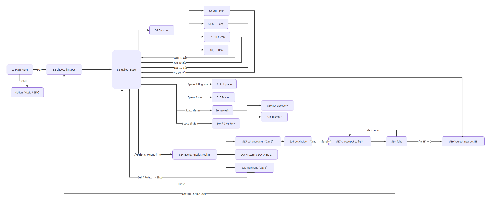

# BePal — Scene Breakdown

> **หมายเหตุ:** ปรับให้ตรงกับโค้ดแล้วเมื่อ 2026-10-13 — [06-vertical-slice.md](06-vertical-slice.md) และโค้ดยังเป็นข้อกำหนดหลักของ Prototype
> คอลัมน์ "Programmer" ด้านล่างคือสเปกจาก Figma; ส่วน **As built** อยู่ในตาราง "Scene ที่ implement แล้ว" ท้ายไฟล์ (Base ใช้ A/D + Space ไม่ใช่เมาส์; ไม่มีปุ่ม E)

ฉากทั้งหมดอ้างอิง Figma (Scene 1–20) และฉากเพิ่มเติมจาก GDD v2.0 — เนื้อหาย้ายแบบคงข้อความเดิมจากไฟล์ต้นทาง

ที่มา: แยกจาก [01-core-loop.md](01-core-loop.md) เมื่อ 2026-10-07 · ขอบเขต Prototype ตาม [06-vertical-slice.md](06-vertical-slice.md)

---

## Scene Breakdown (อ้างอิง Figma — 06 · Game Flow Scenes 1–13 และ 07 · Game Flow (Event) Scenes 14–20)

> Draw.io: [diagrams/scene-breakdown.drawio](diagrams/scene-breakdown.drawio) (เปิดด้วย VS Code Draw.io Integration)

| Scene | หน้าจอ | UI บนหน้าจอ | Programmer | Art |
| --- | --- | --- | --- | --- |
| **1** | Main Menu | BePal, Play, Option, Quit, "Space to Enter" | Play → เลือกสัตว์, Option → setting, ทำ transition เมื่อเปลี่ยน scene | รูป Spacebar + "Space to Enter", รูป WASD, รูปลูกศร, ชื่อเกม "BePal", ปุ่ม Play/Option/Quit, Menu Background |
| — | Option | Music, Sound effects | ✅ `OptionsScene` (As built) — ดู As built ท้ายไฟล์ | — |
| **2** | Choose first pet | "Choose your pet", ไอ่แดง / ไอ่เขียว / ไอ่ซุง | คลิ๊กเลือกสัตว์, hover ขึ้นกรอบรอบตัวสัตว์, เลือกแล้วเข้า Base | รูปสัตว์, รูปสัตว์กรอบเรืองแสง (hover), dialogue box, Base Background (Blur) |
| **3** | Habitat Base | Day, Coin, ชื่อสัตว์, Player LV + EXP, Upgrade icon, สมุด, End day (E) | คลิ๊กประตู = รับ Event (Day 2+), คลิ๊กสมุด/อัปเกรด/สัตว์/หมอได้, ทำ progress bar, ทุกวันใหม่ Stomach & Clean ลด, End day กดได้ทุกเมื่อ | UI สมุด, UI upgrade, รูปหมอ, รูปประตู, UI energy, progress bar overlay, UI Coin, Text Day, Base Background |
| **4** | Care pet | วงล้อ Train / Feed / Clean / Heal, ESC | วงล้อ QTE 4 choice สี, Spacebar โดน choice ไหนไป scene นั้น (ไม่โดน = ไม่เกิดอะไร), ESC กลับ Base, จอสั่นเมื่อกดโดน | Text แต่ละ choice, UI ESC, Base Background (Blur + dark tone) |
| **5** | QTE Train | EXP, LV, Attempt : 10, Progress Bar | จุดสีแดงเล็ก 3 จุดพร้อมกัน สุ่มตำแหน่ง (As built; โดนแล้วเกิดใหม่จน Attempt = 0), เข็มหมุนเร็วกว่าปกติ, progress bar แยกสี — ดู [08-care-qte §3.2](08-care-qte.md) | progress bar, UI energy ลด, ข้อความ feedback Miss / Perfect / Great, Background (Blur + dark tone) |
| **6** | QTE Feed | Stomach, Attempt : 10 | จุดสีเหลือง (ใหญ่กว่าแดง), กดโดน = เปลี่ยนทิศการหมุน + จุดเกิดใหม่ | *(ไม่ระบุ)* |
| **7** | QTE Clean | Clean, Attempt : 10 | จุดสีฟ้า ขยับหนีไปทิศเดียวกับเข็ม (As built: 4.8 rad/s เร็วกว่าเข็ม) | *(ไม่ระบุ)* |
| **8** | QTE Heal | Heal, Attempt : 10 | จุดสีเขียว, เข็มกะพริบเฟดหาย/กลับมา, choice ค่อยๆ หดสั้น | *(ไม่ระบุ)* |
| **9** | สมุดหลัก | pet discovery, Disaster, ESC | เลือกหัวข้อ, hover มีกรอบ, ESC กลับ Base, ดูได้เฉพาะสัตว์ที่มี / Disaster ที่เคยผ่าน | background สมุด, pet discovery UI, Disaster UI |
| **10** | สมุด pet discovery | Day, Coin, LV, Stomach, Clean, Health, ไอคอนธาตุ, คำอธิบายสัตว์, ESC | กดลูกศรไปหน้าถัดไป, ESC กลับ Base | *(ไม่ระบุ)* |
| **11** | สมุด Disaster | Day, Coin, ชื่อภัย (เช่น Thunder storm), คำอธิบาย, ESC | กดลูกศรไปหน้าถัดไป, ESC กลับ Base | รูป disaster |
| **12** | Upgrade | Points, Coin, QTE / Energy / Progress Bar + REQ | ดู [03-mechanics §1.3](03-mechanics.md) | Upgrade background, ปุ่ม +, Text QTE/Energy/Progress Bar, (อยากให้มี) icon points |
| **13** | Doctor | Day, Coin, Player LV, "Choose pet", ราคา 250 | ไม่มีสัตว์ HP = 0 → แสดงแค่ "choose pet", มี → แสดงรูป + ราคาชุบชีวิต, หลายตัวใช้ลูกศรเลื่อน, คลิ๊ก → "Are you sure?" Yes = กลับ Base พร้อม HP = 1 / No = กลับหน้าเลือก, ESC กลับ Base | Doctor Background |
| **14** | Event (Knock Knock !!) | "Knock Knock !!", Day, Coin, Player LV, End day | Event เกิดหลังกด End day แล้วขึ้นวันใหม่, สุ่ม 3 แบบ | icon knock |
| **15** | pet encounter | ชื่อสัตว์ (เช่น Toothless) + บทพูด | เกิดเมื่อกดประตูแล้วเจอสัตว์ตัวใหม่, คลิ๊กเพื่อข้ามข้อความ | *(ไม่ระบุ)* |
| **16** | pet choice | Chase, Tame | Chase = กลับฐานไม่ต้องสู้ไม่เสีย Energy, Tame = เข้าสู่การต่อสู้ | *(ไม่ระบุ)* |
| **17** | choose pet to fight | "Choose your pet" | คลิ๊กสัตว์เพื่อเข้าสู่การต่อสู้, hover ขึ้นกรอบ | *(ไม่ระบุ)* |
| **18** | fight | Health, Dodge, Attack, ชื่อท่า (เช่น Acid) | ดู Combat Loop ด้านบน / [09-combat-encounters §4.2](09-combat-encounters.md) | *(ไม่ระบุ)* |
| **19** | รับ new pet | "You got new pet !!!" | *(ยังเป็นข้อความทดสอบในบอร์ด)* | *(ไม่ระบุ)* |
| **20** | Merchant | Day, Coin, Merchant: "I'm quite interested your toothless… can you give it to me?" | *(ยังไม่ได้เขียนรายละเอียดในบอร์ด)* | *(ยังไม่ได้เขียนรายละเอียดในบอร์ด)* |

> **ส่วนที่ยังไม่ได้ออกแบบใน Figma (แต่มีโค้ดแล้ว):** หน้า Option (`OptionsScene`), Disaster event (Day 4 พายุ — `DayEvents`), Scene 19–20 (รับ Toothless +200 coin; พ่อค้า Sell/Refuse → ร้านค้า) · ยังไม่ทำ: Daily Summary Report Card / Emergency Revive modal

### ฉากเพิ่มเติมจาก GDD v2.0 (ยังไม่มีใน Figma)

1. **Prologue:** ✅ มี — dialogue 4 บรรทัดหลังเลือกสัตว์ (`MenuScenes.cs`)
2. **Morning Briefing:** ✅ มีในรูป dialogue "Morning" หลัง Night สรุป "+100 coin, energy restored."
3. **Daily Summary Report Card:** ⏳ ยังไม่ทำ (เกรด S–F, โบนัส) · **Night Rest Screen:** ✅ `NightScene` เป็นแค่ fade "Day N is over..."

### Scene ที่ implement แล้ว (As built, 2026-10-13)

| Scene | Class (ไฟล์) | พฤติกรรมจริง |
| --- | --- | --- |
| Main Menu | `MainMenuScene` (`MenuScenes.cs`) | ปุ่ม Play / Options / Quit; `Space` = Play; subtitle "a sanctuary at the edge of the universe"; hint "A / D Walk · SPACE Interact / QTE · Mouse UI" |
| Options | `OptionsScene` | Music / Sound effects: `W`/`S` เลือก, `A`/`D` ปรับ (step 0.05), `Esc` กลับ + บันทึก; เปิดจาก Main Menu และ Pause |
| Choose pet | `ChooseStarterScene` | Mossling / Nibbleclaw / Blinkbun (การ์ดแสดง ธาตุ, HP, ATK); เลือกด้วยเมาส์ หรือคีย์ `1`–`3` |
| Base (Scene 3) | `BaseScene` | side-scroller: `A`/`D`(ลูกศร) เดิน · `Shift` วิ่ง · `Space` โต้ตอบ `[Space] {label}` · `Esc` Pause (Resume / Options / Main Menu) · `F3` overlay · HUD: Day, Coin, Energy pips, Player LV+EXP, Points · ประตู: "Open the door"/"Red door" (วันที่ไม่มี event: "Nothing else is out there today... you hope.") · เตียงถูกบล็อกถ้า event ค้าง ("Knock... knock... Something is at the red door.") · ไม่มี Energy: "No energy left. Sleep at the bed to rest." |
| Care (4–8) | `CareSelectScene`, `QteScene` | ดู [08](08-care-qte.md); เปิดช่อง Heal เป็นสีเทาเมื่อ HP เต็ม; หน่วง 0.4 วิ ก่อนเข้า QTE |
| Notebook (9–11) | `NotebookScene` | `A`/`D` เปลี่ยนหน้า · `Esc` ในหน้าย่อยกลับสมุดหลัก · หน้าสัตว์: LV, ATK, Health, Stomach, Clean, ธาตุ, คำอธิบาย, Passive · หน้า Disaster: เฉพาะ Thunder storm (ไม่มี Day/Coin) |
| Upgrade (12) | `UpgradeScene` | coin + Points ต่อ level — ดู [03 §1.3](03-mechanics.md) |
| Doctor (13) | `DoctorScene` | การ์ดสัตว์เรียงแถว (ไม่มีลูกศร); "Are you sure? Revive {name} for 250 coin." / "You don't have enough coin."; ไม่มีสัตว์ตาย: "All your pets are alive. Come back if that changes." |
| Box | `InventoryScene` | ใช้ไอเทมที่ซื้อ (การ์ดแบบเดียวกับร้าน, ปุ่ม Use) |
| Shop | `ShopScene` | เปิดหลังพ่อค้า Day 3 ทั้ง Sell/Refuse; 7 ไอเทม ≤ 3 ต่อชนิด |
| Dialogue (15) | `DialogueScene` | typewriter 55 ตัวอักษร/วินาที (`TextSpeed`); `Space`/คลิกครั้งแรก = แสดงเต็มบรรทัด, ครั้งต่อไป = ถัดไป |
| Choice / PetPick (16–17) | `ChoiceScene`, `PetPickScene` | PetPick รับคีย์ `1`–`4` และ `Esc` ยกเลิกกลับตัวเลือก |
| Fight (18) | `FightScene` | ดู [09](09-combat-encounters.md); banner "VICTORY"/"DEFEATED" |
| Events | `DayEvents` | Day 2 Toothless · 3 พ่อค้า · 4 Storm · 5 Big Z |
| Night | `NightScene` | fade "Day N is over..." แล้ว `AdvanceDay` + dialogue "Morning" |
| Game Over | `GameOverScene` | "GAME OVER" + เหตุผล + "Space Choose a new pet" |
| To Be Continued | `ToBeContinuedScene` | จบ Prototype หลัง Big Z; แสดงจำนวนวันที่รอด |
| Dev | `SceneJumpScene` (F2), F3 overlay | ดู [04](04-class-diagram.md) |
